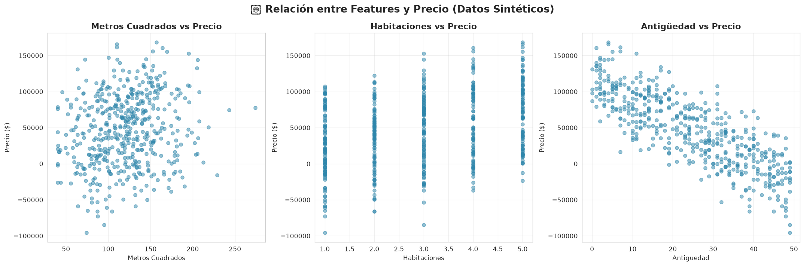
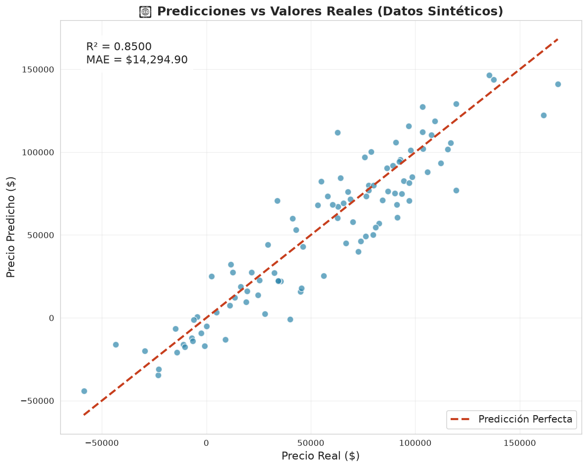
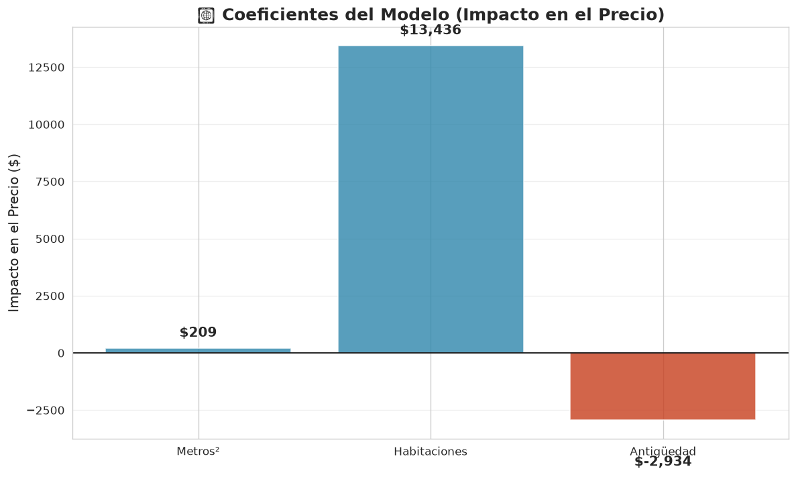
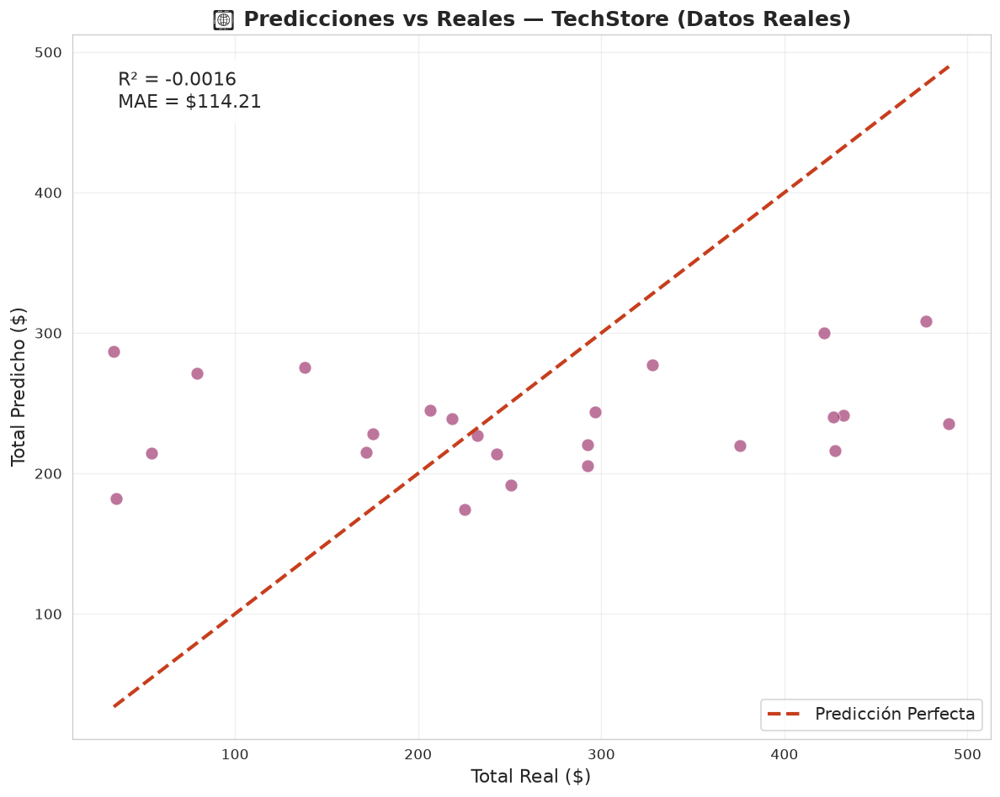
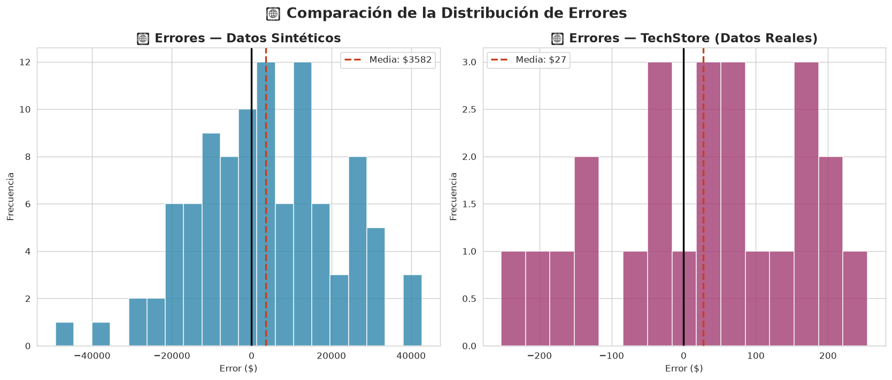
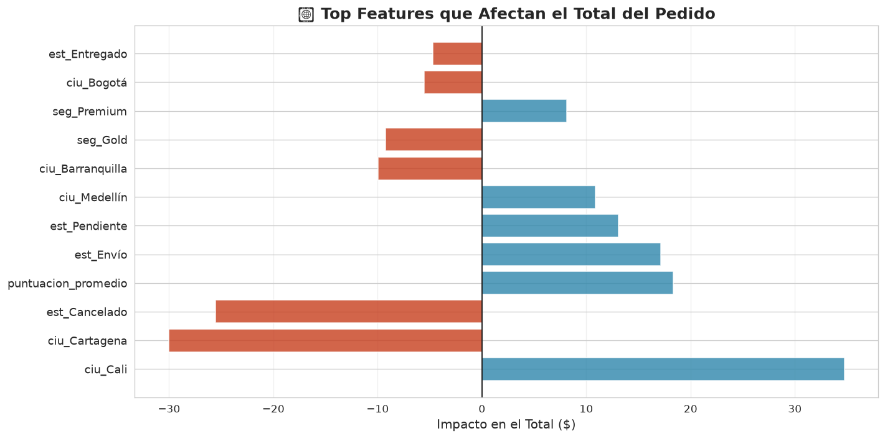

# 🎯 Regresión Lineal — De la teoría a la práctica con scikit-learn

**Nivel:** 3 | **Skill:** Regresión Lineal, scikit-learn, métricas, train/test split  
**Ruta:** ML Clásico → Tu primer modelo de Machine Learning

---

## 📖 Qué vas a aprender

Hoy construyes **tu primer modelo de Machine Learning** — ¡y no uno, sino DOS!

### ¿Qué es la regresión lineal?

Imagina que quieres predecir el precio de una casa. Sabes que:
- A más metros cuadrados → más cara
- A más habitaciones → más cara
- A más años de antigüedad → más barata

La **regresión lineal** combina toda esa información en una fórmula como:

```
precio = 200 × m² + 15000 × habitaciones - 3000 × años + 50000
```

Cada número (200, 15000, -3000) es un **coeficiente** que el modelo aprende automáticamente mirando datos de ejemplo.

### ¿Por qué este proyecto tiene DOS partes?

1. **Parte 1 — Datos sintéticos**: Creamos datos donde SABEMOS la fórmula exacta. Así puedes VER que el modelo descubre la relación correcta. R² alto, todo perfecto.

2. **Parte 2 — TechStore real**: Aplicamos el mismo método a datos reales de una tienda. Aquí el modelo tendrá R² más bajo porque el mundo real es ruidoso.

3. **Parte 3 — Comparación**: Entiendes CUÁNDO funciona bien y CUÁNDO no.

### ¿Dónde se usa en la vida real?

- **Bienes raíces**: Zillow predice precios de casas
- **Finanzas**: Predecir el valor de acciones
- **Ventas**: Pronosticar ingresos mensuales  
- **MLOps**: Estimar tiempos de entrenamiento

---

## 🧪 Código paso a paso

### Paso 1: Importar librerías

```python
import pandas as pd
import numpy as np
from sklearn.model_selection import train_test_split
from sklearn.linear_model import LinearRegression
from sklearn.metrics import r2_score, mean_absolute_error
```

**scikit-learn** es la librería de ML más popular. Tiene modelos listos para usar.

### Paso 2: Crear datos sintéticos (Parte 1)

Creamos 500 casas con una fórmula conocida:
```python
precio = 50000 + 200×m² + 15000×habs - 3000×años + ruido
```

El "ruido" simula que los datos reales nunca son perfectos.

### Paso 3: Train/Test Split

```python
X_train, X_test, y_train, y_test = train_test_split(
    X, y, test_size=0.2, random_state=42
)
```

**Regla de oro del ML:** Nunca evalúes con los mismos datos de entrenamiento.
- **80% train** → el modelo aprende aquí
- **20% test** → evaluamos con datos NO VISTOS

### Paso 4: Entrenar

```python
modelo = LinearRegression()
modelo.fit(X_train, y_train)
```

Dos líneas. `fit()` encuentra los coeficientes óptimos automáticamente.

### Paso 5: Evaluar

```python
y_pred = modelo.predict(X_test)
r2 = r2_score(y_test, y_pred)
mae = mean_absolute_error(y_test, y_pred)
```

| Métrica | Qué mide | Ideal |
|---------|----------|-------|
| **R²** | % de varianza explicada por el modelo | 1.0 |
| **MAE** | Error promedio (en $) | 0 |
| **RMSE** | Penaliza errores grandes | 0 |

### Paso 6: Interpretar coeficientes

```python
modelo.coef_  # [200.12, 14987.5, -2995.3]
```

Los coeficientes aprendidos deberían acercarse a los reales (200, 15000, -3000).

---

## 📊 Resultados esperados

### Datos Sintéticos — Relación Lineal Perfecta


Cada gráfico muestra una característica vs el precio. La tendencia lineal es clara.

### Predicciones Perfectas


Los puntos se alinean cerca de la diagonal (predicho ≈ real). R² > 0.85.

### Coeficientes Aprendidos


El modelo descubre que metros² y habitaciones AUMENTAN el precio, mientras la antigüedad lo DISMINUYE.

### TechStore — Datos Reales


Con datos reales el modelo es menos preciso. ¡Esto es NORMAL en ML!

### Comparación de Errores


Los errores sintéticos son pequeños y centrados en 0. Los reales son más grandes y dispersos.

### Factores que Importan en TechStore


Las barras naranjas RESTAN valor, las azules SUMAN. Cada barra es el impacto de esa característica.

---

## 💡 Conceptos clave

| Concepto | Explicación |
|----------|-------------|
| **Regresión Lineal** | Modelo que aprende una relación lineal entre features y target |
| **Coeficientes** | Pesos w₁, w₂... que multiplican a cada feature |
| **Intercepto (sesgo)** | Valor base del target cuando todas las features son 0 |
| **Train/Test Split** | Dividir datos en 80% entrenamiento + 20% prueba |
| **R²** | Proporción de varianza explicada por el modelo |
| **MAE** | Error absoluto promedio en unidades del target |
| **RMSE** | Raíz del error cuadrático medio (penaliza outliers) |
| **Ruido** | Variación aleatoria que NO puede explicarse con las features |
| **Datos sintéticos** | Datos creados artificialmente con una relación conocida |
| **Inferencia** | Usar el modelo entrenado para predecir datos nuevos |

---

## 🚀 Siguiente paso

¡Has construido tu primer modelo de ML! 🎉

**Próximo proyecto: Clasificación con KNN o Árbol de Decisión**

Pasamos de predecir **números** (regresión) a predecir **categorías** (clasificación). Por ejemplo:
- ¿Este email es spam o no?
- ¿Este cliente comprará o no?
- ¿Qué categoría de producto prefiere?

Conceptos nuevos: precisión, recall, matriz de confusión, validación cruzada.

---

> *"La regresión lineal es al ML lo que las escalas son a la música: simple, pero fundamental."* 🎵

---

### 📁 Estructura del proyecto

```
2026-06-24-linear-regression/
├── README.md          ← Esta guía
├── project.py         ← El código completo
├── requirements.txt   ← Dependencias
├── data/              ← Datos de TechStore
│   └── dataset_completo.csv
├── docs/              ← Visualizaciones generadas
│   ├── 01_sinteticos_relaciones.png
│   ├── 02_sinteticos_predicciones.png
│   ├── 03_sinteticos_coeficientes.png
│   ├── 04_reales_predicciones.png
│   ├── 05_comparacion_errores.png
│   └── 06_reales_coeficientes.png
├── models/            ← Modelos guardados (futuro)
├── notebooks/         ← Jupyter notebooks (opcional)
└── LEARNINGS.md       ← Qué aprendiste hoy
```
